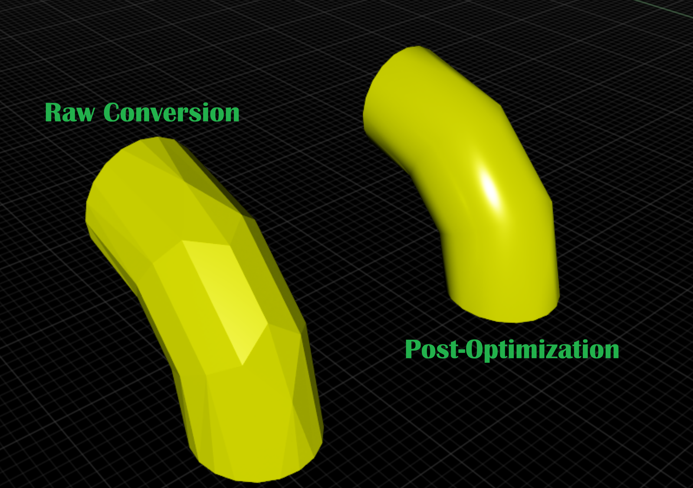

# usd-convert-cad Limitations

This file records known limitations for the `usd-convert-cad` package and the `omniverse-cad-to-usd` agent skill that drives it.

## Platform Support

- AutoCAD (`.dwg`, `.dxf`) and Revit (`.rvt`, `.rfa`) conversion is **not supported on `linux-aarch64`**. The HOOPS Exchange DWG/Revit readers are not available for that architecture, so these conversions fail with `A3D_LOAD_INVALID_FILE_FORMAT` (error code `-10005`) and produce no output.
- These formats are supported on `windows-x86_64` and `linux-x86_64`. All other listed formats are supported on all three platforms.
- Do not attempt DWG/DXF or RVT/RFA conversion on `linux-aarch64`; treat those inputs as unsupported on that platform.

## File Size

- Loading Revit source CAD files that are 2 GB or larger can fail due to a HOOPS Exchange SDK limitation.

## Revit Families

- Nested Revit families can be flattened during conversion and merge into one component in the resulting USD hierarchy.

## Material Preservation

- The HOOPS converter preserves physically based rendering (PBR) material
  properties only for glTF (`.gltf` and `.glb`) input. For other CAD and
  interchange formats, conversion may preserve basic colors and material
  assignments but does not preserve the complete source PBR material model.

## Revit Pipe Catalog Elements

### Insufficient Tessellation Quality on Native Revit Pipe Catalog Elements

- When converting Revit models containing pipe catalog elements (pipes, elbows, couplings, tees, etc.), curved surfaces may appear faceted rather than smooth.
- This can result in visible shading artifacts on cylindrical and curved pipe components in the converted USD output.
- Post-conversion mesh cleanup plus normal generation can improve the visual quality of affected pipe elements.

The example below shows a faceted raw conversion and the smoother result after post-conversion mesh cleanup and normal generation.



Recommended workaround:

1. Convert the Revit file to USD with normals disabled, for example by using `--no-normals`.
2. Disable instancing or instanceability on the meshes that need the workaround.
3. Run the `usd-optimize` `meshCleanup` operation with vertex welding enabled.
4. Run the `usd-optimize` `generateNormals` operation with default settings.
5. Inspect curved pipe and elbow surfaces in the final USD asset.

Example `usd-optimize` operation stack:

```json
[
    {
        "operation": "meshCleanup",
        "mergeVertices": true
    },
    {
        "operation": "generateNormals"
    }
]
```

Install `usd-optimize` separately in the same Python 3.12 environment used for `usd-convert-cad`, then run the optimizer script after conversion finishes. The standalone `usd-convert-cad` CLI does not include a built-in post-processing runner.

```powershell
python -m pip install usd-optimize
usd-convert-cad -i model.rvt -o converted.usdc --no-normals --instancing-style none
python post_process_pipe_normals.py
```

Example Python post-process:

```python
from pxr import Usd
from usd_optimize.core import ExecutionContext, UsdOptimizeCore

input_path = "converted.usd"
output_path = "converted_pipe_normals.usd"

stage = Usd.Stage.Open(input_path)
context = ExecutionContext()
context.set_stage(stage)

results = UsdOptimizeCore.getInstance().executeConfig(
    context,
    [
        {
            "operation": "meshCleanup",
            "mergeVertices": True,
        },
        {
            "operation": "generateNormals",
        },
    ],
)

for success, error, _output in results:
    if not success:
        raise RuntimeError(error)

stage.Export(output_path)
```

Mesh cleanup is important because normal generation works best when neighboring triangles share vertices. Use the workaround selectively on affected curved pipe geometry; aggressive smoothing across an entire model may soften hard-edged objects that should remain crisp.

## Creo Simplified Representations

### Creo Simplified Representation May Exclude Child Parts When Parent Assembly Is Excluded

- When converting Creo (Pro/E) files using the **View Layer Name** option to extract a simplified representation, child parts may be incorrectly excluded from the converted USD output even when they are specified to load as a different representation.
- This is a limitation in the HOOPS Exchange SDK. Support for Creo Simplified Representations was introduced in HOOPS Exchange 2026.1.0 and improvements are being worked on by TechSoft.

Default Simplified Representation in Creo


Custom Simplified Representation in Creo


Default Simplified Representation Converted in HOOPS Demo Viewer 2026.1.1


Custom Simplified Representation Converted in HOOPS Demo Viewer 2026.1.1


## 2D Geometry Conversion

- Pass `--convert-curves` to convert visual 2D model-space linework from DWG/DXF files into USD `BasisCurves`. Filled regions may convert as meshes independently of this option.
- Paper-space layouts (title sheets / print layouts) are not supported; only model-space content is converted.
- Text, dimensions, and other annotations are not preserved as text.
- DWG and Revit file reading is not supported on `linux-aarch64`; see [Platform Support](#platform-support).

## Assembly Constraints

- Assembly-constraint export is disabled by default. Pass `--read-constraints` to enable it.
- Supported mappings include CATIA V5, NX, and SolidWorks `Fix`, CATIA V5 `Fix Together`, NX `Bond`, and SolidWorks `Lock` mate constraints.
- The converter exports supported constraints as USD Physics fixed joints. It does not apply rigid-body or collision APIs.
- Unsupported constraint types and unresolved constraint targets are not exported.
- The `--read-constraints` option is independent of `--convert-physics-data`.

## Format Interpretation

- `.prt` and `.asm` file interpretation depends on source content because multiple CAD systems use those extensions.

## Runtime Requirements

- This wheel supports one converter core and does not expose converter selection.
- Installation requires network access to the Python package index hosting the wheel.

## References

- [HOOPS Core converter known issues](https://docs.omniverse.nvidia.com/kit/docs/omni.kit.converter.hoops_core/latest/Known_Issues.html#known-issues)
